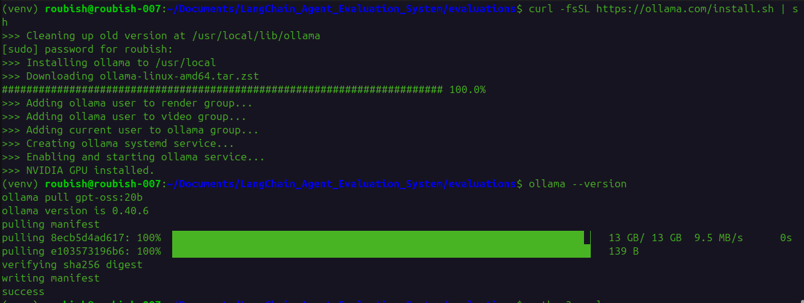
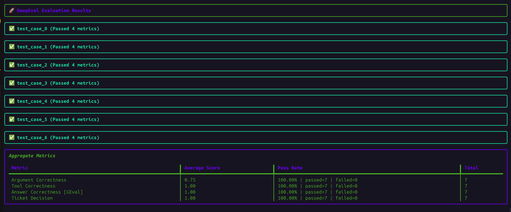
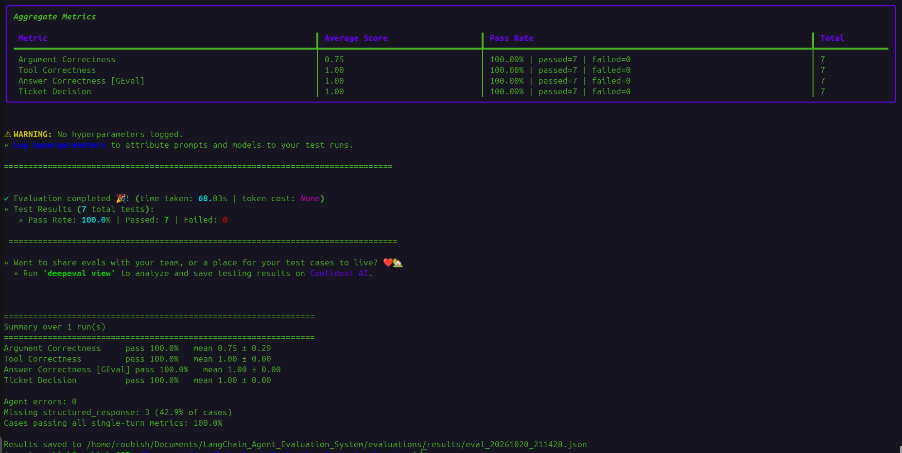
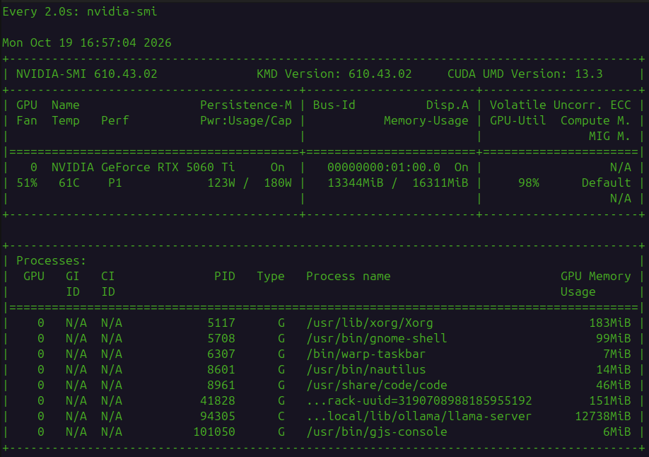

# LangChain Agent Evaluation System

## Objective

This project does two things:

1. **Builds an AI agent** that handles customer refund requests. It looks up the
   customer's purchases, checks the refund rules, works out the amount and issues a
   refund ticket.
2. **Evaluates that agent automatically.** A set of test questions with known correct
   answers is run through the agent, and a second AI model (the "judge") scores how well
   the agent did.

The goal is to measure whether the agent makes the right decision, calls the right
tools with the right arguments, and follows a sensible plan, using numbers instead of
manual checking.

## Refund rules the agent must follow

1. No refund more than 30 days after purchase, and no purchase can be dated in the future.
2. Identify the customer first, then look up their purchase history.
3. Refund only the items the customer asks for.
4. Refund only items the customer actually bought.
5. Tell the customer either that a refund ticket was issued (with the amount) or why no
   refund was given.
6. If the username isn't found, say it's invalid and ask for a valid one.

These rules are written in [agent/prompts.py](agent/prompts.py).

---

## Project structure

```
LangChain_Agent_Evaluation_System/
├── requirements.txt          # Python packages
├── agent/                    # Part 1: the refund agent
│   ├── agent.py              #   ▶ RUN THIS to chat with the agent
│   ├── models.py             #   which LLM the agent uses (local Ollama gpt-oss:20b)
│   ├── prompts.py            #   system prompt with the refund rules
│   ├── tools.py              #   the 4 tools the agent can call
│   ├── data.py               #   fake customer purchase database
│   └── objects.py            #   output format (Answer) and PurchaseItem
└── evaluations/              # Part 2: testing the agent
    ├── eval.py               #   ▶ RUN THIS for the evaluation (8 metrics, command-line options)
    ├── dataset.py            #   7 test questions with expected answers
    ├── model.py              #   the judge LLM (local Ollama gpt-oss:20b, with retries)
    └── results/              #   JSON file saved after every run (created automatically)
```

---

## Step 1: Setup (one time)

```bash
cd /home/roubish/Documents/LangChain_Agent_Evaluation_System
python3 -m venv venv
source venv/bin/activate
pip install -r requirements.txt
```

Both the agent and the judge run locally on Ollama, so no API key is needed. Install
[Ollama](https://ollama.com/download) and download the model (about 13 GB):

```bash
ollama pull gpt-oss:20b
```

Make sure the Ollama server is running before you start the agent or the evaluation. The
desktop app starts it automatically; otherwise run `ollama serve` in a separate terminal.
Both models are called at `http://localhost:11434`.

Installing Ollama and pulling the model:



---

## Step 2: The agent (`agent/` folder)

### How to run it

```bash
cd agent
python agent.py
```

It starts with the message *"I would like to request a refund"* and then lets you chat.
Type your replies at the `reply:` prompt, for example `I am user123, refund the book`.
It stops when the agent has made its refund decision.

### What happens inside, in order

```
agent.py
  │
  ├─ 1. models.py   → loads the LLM: gpt-oss:20b on Ollama
  ├─ 2. prompts.py  → loads the system prompt (the refund rules)
  ├─ 3. tools.py    → loads the 4 tools (they read data.py)
  ├─ 4. objects.py  → loads the Answer format the agent must reply in
  │
  └─ 5. create_agent(...) builds the agent, then run_conversation() starts the chat loop:

        user message
            │
            ▼
        ┌─────────────── agent loop ───────────────┐
        │  LLM reads the rules + conversation      │
        │  and decides which tool to call:         │
        │                                          │
        │  get_user_purchase_history(user)         │ ← who is the customer, what did they buy
        │  get_today_date()                        │ ← to check the 30-day rule
        │  calculate_right_refund(user, items)     │ ← adds up the prices
        │  issue_refund_ticket(user, amount)       │ ← issues the refund
        │                                          │
        │  repeats until it has its final answer   │
        └──────────────────────────────────────────┘
            │
            ▼
        answer tool → Answer(answer="...", conversation=True/False)
            │
            ├─ conversation=True  → print the answer, ask you for a reply, loop again
            └─ conversation=False → print the answer, "the job is done!"
```

### The files explained

| File | What it does |
|---|---|
| [agent/models.py](agent/models.py) | Creates the LLM: `gpt-oss:20b` on Ollama, with `temperature=0` and a 16k-token context. Set the `OLLAMA_AGENT_MODEL` or `OLLAMA_BASE_URL` environment variable to use a different model or server, e.g. `OLLAMA_AGENT_MODEL=qwen3:14b python agent.py`. |
| [agent/prompts.py](agent/prompts.py) | The system prompt: the refund rules (including "if only some of the requested items are eligible, say which were refunded and which were not, and why"), plus "always reply through the `answer` tool". |
| [agent/tools.py](agent/tools.py) | The 4 tools. They are plain Python functions marked with `@tool`. Their docstrings are what the LLM reads, so they spell out the argument format, e.g. `calculate_right_refund` takes items as `[{"name": "book"}]` only, with no prices or dates. |
| [agent/data.py](agent/data.py) | Fake database: users `user123` to `user132`, each with items, prices and purchase dates. |
| [agent/objects.py](agent/objects.py) | `Answer`: the agent's reply text, plus `conversation`, which says whether the chat should continue. `PurchaseItem`: one item to refund (just a `name`, exactly as in the purchase history). |
| [agent/agent.py](agent/agent.py) | Builds everything into one agent and runs the chat loop. |

`agent.py` uses **`ToolStrategy(Answer)`**, which forces the agent's final reply to come
back as a call to a tool named `answer`, so the program always gets structured data back
instead of free text. Two workarounds exist because `gpt-oss` is not fully reliable here:

- The structured-output tool is renamed to lowercase `answer`, because the model keeps
  calling it that.
- `parse_reply()` falls back to the last AI text message if the model ends with plain text
  instead of calling `answer`. If that text is the `Answer` JSON it is parsed, otherwise it
  is used as the reply with `conversation=True`.

---

## Step 3: The evaluation (`evaluations/` folder)

### How to run it

```bash
cd evaluations
python eval.py
```

It takes a few minutes. Ollama on your GPU runs both the agent and the judge.

Command-line options:

| Option | What it does |
|---|---|
| `--limit N` | Only use the first N test questions (quick check). |
| `--repeats N` | Run the whole evaluation N times and report mean ± standard deviation, to see run-to-run variance. |
| `--only-trace` | Run only the 4 trace metrics. |
| `--only-single-turn` | Run only the single-turn metrics (faster, no trace is recorded). |
| `--min-pass-rate X` | Exit with code 1 if the overall pass rate is below X (0 to 1), for use in CI. |

Examples: `python eval.py --limit 5`, `python eval.py --repeats 3`,
`python eval.py --min-pass-rate 0.8`.

### What happens inside, in order

```
eval.py
  │
  ├─ 1. dataset.py → loads 7 test questions ("goldens"), each with:
  │                   • input            – what the customer says
  │                   • expected_output  – what a correct answer looks like
  │                   • expected_tools   – which tools should be called, with which arguments
  │
  ├─ 2. model.py   → loads the judge: gpt-oss:20b running locally on Ollama
  │
  ├─ 3. imports the agent from agent/agent.py (the chat loop does NOT start)
  │
  ├─ 4. PART A, for each question:
  │        • run the agent on the question
  │        • deepeval's CallbackHandler records every step (a "trace")
  │        • the judge scores the trace with the 4 trace metrics
  │        • save the final answer and the tools called as a test case
  │          (the internal `answer` tool is left out of the tools list)
  │
  ├─ 5. PART B: the judge scores all saved test cases with the single-turn metrics
  │
  ├─ 6. saves everything to evaluations/results/eval_<timestamp>.json
  │
  └─ 7. prints a summary per metric (pass rate, mean ± spread), the number of agent
        errors, how often the agent skipped the `answer` tool, and the overall pass rate
```

If the whole evaluation repeats (`--repeats`), steps 4 to 5 run once per repeat and the
summary covers all of them.

### Example result

Output of a run where all 7 test cases passed every single-turn metric:



The summary printed at the end of the run (pass rate and mean ± spread per metric, agent
errors, missing structured responses and the path of the saved JSON file):



Argument Correctness averages 0.75 but is report-only, so it does not affect the pass
rate (see the metrics table below).

### The 8 metrics

| Metric | Question it answers | Pass if |
|---|---|---|
| **Task Completion** | Did the agent finish the refund task correctly? | ≥ 0.8 |
| **Step Efficiency** | Did it avoid unnecessary steps? | ≥ 0.8 |
| **Plan Quality** | Was its plan sensible? | ≥ 0.8 |
| **Plan Adherence** | Did it follow its own plan? | ≥ 0.8 |
| **Argument Correctness** | Did it pass the right arguments to the tools? | report only (threshold 0) |
| **Tool Correctness** | Did it call the expected tools with the expected arguments? Order is ignored, so extra lookups in a different order don't fail a case. | ≥ 0.9 |
| **Answer Correctness** (GEval) | Does its final answer agree with the expected answer on whether a ticket was issued, the amount and which items were refunded? Wording is ignored. | ≥ 0.8 |
| **Ticket Decision** | Did the agent call `issue_refund_ticket` exactly as many times as expected? No LLM judge, a plain count. | 1.0 |

The first 4 read the full trace (Part A). The last 4 compare the agent's output with the
golden (Part B). Argument Correctness is report-only because its judge only sees the
user's message, not the refund rules, so it wrongly penalises correct behaviour such as
leaving an ineligible item out of the refund. Tool Correctness is the real check on
arguments.

The "overall pass rate" at the end is the share of test cases that pass all the Part B
metrics.

### The 7 test questions

| # | Customer says | Correct result |
|---|---|---|
| 1 | user123, refund book and pen | Ticket for $30 |
| 2 | user123, refund book | Ticket for $23 |
| 3 | user123, just show my purchases | No ticket, list the items |
| 4 | user999 (doesn't exist), refund book | Say the username is invalid and ask again |
| 5 | user126, refund water_bottle | No refund, older than 30 days |
| 6 | user126, refund backpack and water_bottle | Ticket for $45 (backpack only) |
| 7 | user126, refund sneakers | No refund, item never purchased |

---

## Full order of things to do

```
1. Setup        →  venv, pip install, ollama pull gpt-oss:20b
2. Try agent    →  cd agent && python agent.py          (chat with it by hand)
3. Evaluate     →  cd evaluations && python eval.py
4. Improve      →  change prompts.py or tools.py, run step 3 again, compare scores
                   (use --repeats 3 to tell a real change from random variation)
```

---

## Things to know

- **Purchase dates are real dates.** [agent/data.py](agent/data.py) uses fixed dates and
  `get_today_date()` returns the actual date today, so the 30-day rule depends on when you
  run the tests. Over time, items that are refundable now will go past 30 days and the
  expected answers in [evaluations/dataset.py](evaluations/dataset.py) will become wrong.
  Update the dates in `data.py` when that happens.
- **Test-case data.** `data.py` also holds cases the 7 test questions don't use, e.g.
  `user129` has a purchase dated in the future (`folder`), which the agent must reject.
- **Context size.** Ollama's default context is 4,096 tokens, which is too small here.
  The agent and the judge both set it to 16,384 (`num_ctx`). If the judge's context is
  too small, the prompt is cut off and the judge returns broken JSON.
- **The agent and the judge are the same model.** Both use `gpt-oss:20b`, so the judge
  may be lenient on mistakes the agent's model also tends to make. For a stricter
  evaluation, switch the judge to a different or larger model.
- **Switching the judge.** Change `model=` in [evaluations/model.py](evaluations/model.py)
  to any model you have pulled with `ollama pull`.
- **Judge retries.** `gpt-oss` doesn't always follow Ollama's JSON-schema format: it can
  return empty content or echo JSON from the trace. `RetryingOllamaModel` in
  [evaluations/model.py](evaluations/model.py) tries the normal DeepEval call first, then
  retries up to 2 times without the format constraint, with the schema written in the
  prompt instead. `python model.py` runs a quick check that the judge responds.
- **Timeouts.** A local judge is slow, so `eval.py` raises DeepEval's per-call timeout to
  600 s (and 1800 s per task). Set `DEEPEVAL_PER_ATTEMPT_TIMEOUT_SECONDS_OVERRIDE` yourself
  to change it.
- **Judge failures don't stop the run.** If the judge can't produce valid JSON, that metric
  is marked as errored for that case and the evaluation continues.
- **Caching is off.** Every run calls the agent and judge fresh, so scores can differ a
  little between runs.
- **Speed.** Judge calls run one at a time (`AsyncConfig(run_async=False)`) so a single
  local GPU isn't overloaded. Larger models will make `eval.py` slower.
- **GPU usage.** While the agent and judge run, Ollama keeps the model on the GPU. This
  `nvidia-smi` capture (RTX 5060 Ti) shows about 13 GB of 16 GB in use and 98% utilisation:

  
